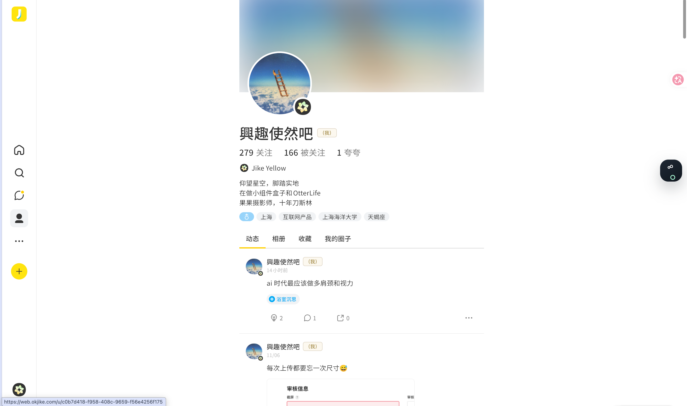
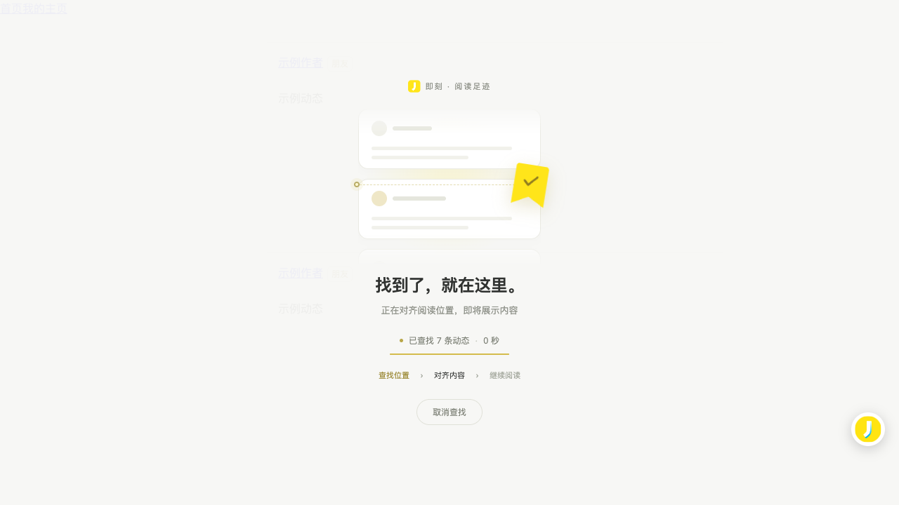
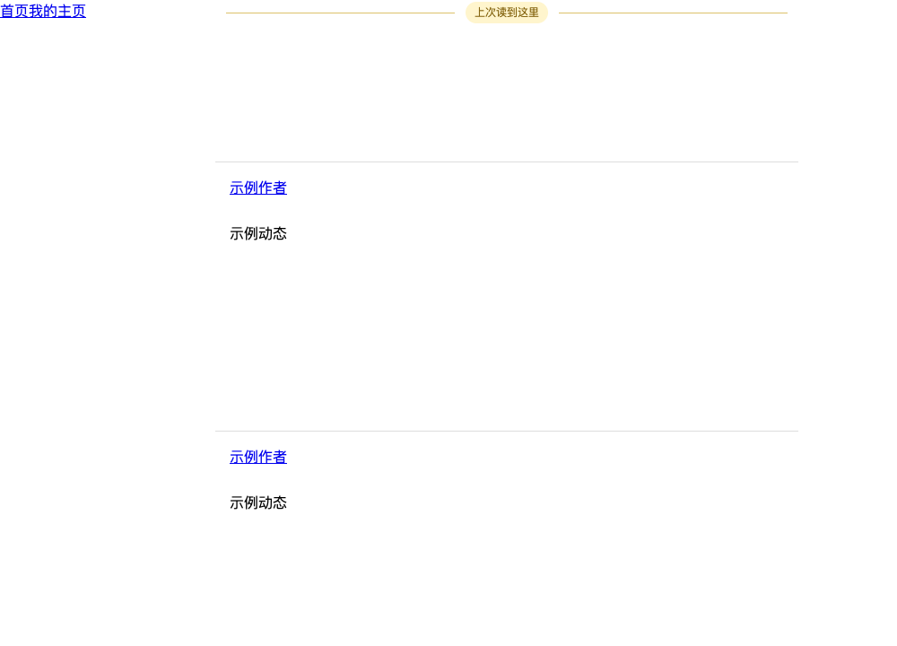
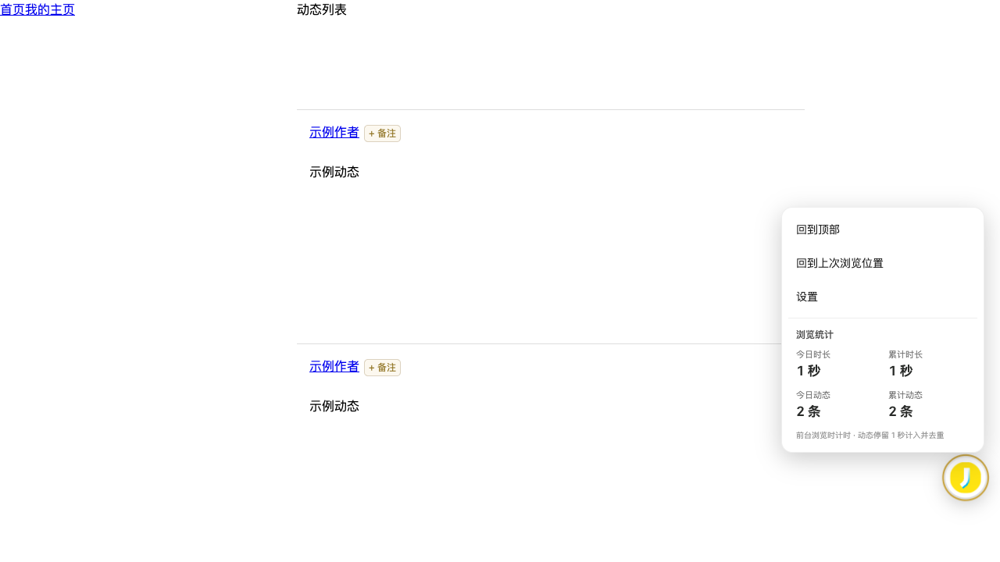
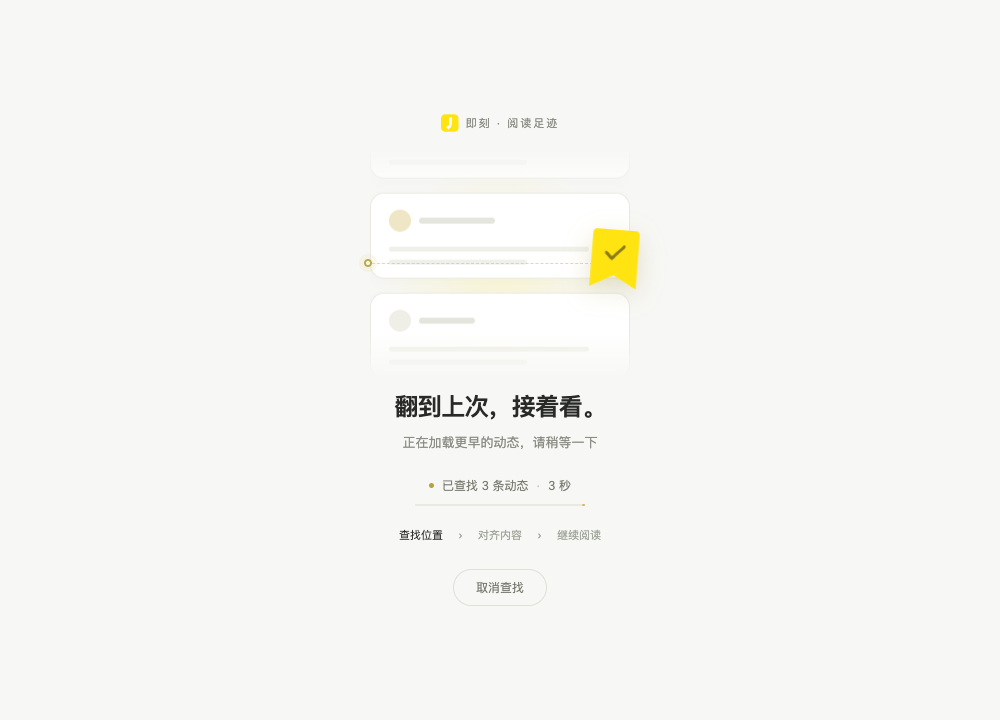

# 即刻私人备注

一个给 [即刻网页版](https://web.okjike.com/) 用的 Chrome / Edge 扩展。

它可以在用户名后添加只属于你的私人备注，也可以记住你在信息流看到的位置。备注和阅读记录只保存在当前浏览器里。

## 你可以用它做什么

### 给用户添加私人备注

- 在即刻网页版的用户名后点击「+ 备注」。
- 输入备注并保存，备注会显示在用户名旁边。
- 点击已有备注可以修改；清空后保存即可删除。
- 首页动态、动态详情页和个人主页动态中的用户名都支持备注。
- 个人主页的「动态 / 相册 / 收藏 / 我的圈子」等分类标签不会显示备注。

### 最近版本预览

恢复阅读位置时会先显示查找动画，定位完成后展示「上次读到这里」分割线：

悬浮球菜单中可以查看今日和累计浏览统计：

较早的阅读记录会显示加载进度和已查找动态数量：

### 直接关注动态作者

- 在信息流或动态详情的作者昵称旁点击「+ 关注」。已关注时显示「已关注」，点击后由即刻确认是否取消关注。
- 自己的动态不显示按钮；无法确认关注状态时，按钮会暂时隐藏。

### 记住信息流阅读位置

扩展会自动记录你最近看到的位置。自动恢复默认关闭，所以打开即刻时不会突然跳转。

页面右下角的即刻图标悬浮球提供三个操作：

- **回到顶部**：回到当前信息流顶部，不会覆盖原来的阅读记录。
- **回到上次浏览位置**：手动回到上次记录的位置。
- **设置**：打开阅读设置、清除记录和备注备份。

如果打开了「自动恢复阅读位置」，进入信息流时会自动回到上次位置。恢复时会显示卡片翻阅和黄色书签动效，同时显示已查找的动态条数、等待时间和当前状态。找到位置并等待页面稳定后再显示内容；完成后会出现「上次读到这里」分割线。按 Esc、滚轮或点击「取消」可以中止恢复。

查找较早的记录可能需要多次加载。每轮最多查找 2 分钟；页面长时间没有加载更多内容时也会暂停。暂停后会回到进入时的位置，并显示「继续查找」，点击可接着查，不会覆盖原来的阅读记录。

### 查看浏览统计

点击悬浮球，菜单下方可以看到今日 / 累计浏览时长，以及今日 / 累计浏览动态数量。统计从安装此版本开始，保存在当前浏览器，并按即刻账号区分。

- 时长只计算信息流在前台且窗口有焦点的时间；切到后台、打开设置或恢复位置时暂停。多标签页重叠时间不会重复累计。
- 动态在视口中停留约 1 秒才计入。今日数量在当天去重，累计数量按历史动态去重；反复查看同一条不会不断增加。
- 「今日」按电脑本地日期计算，跨天自动重新计数；累计数据保留。
- 清除阅读位置不会清除统计。备注备份只包含备注，不包含统计；卸载扩展会清除统计。

## 安装

1. 从 [GitHub 仓库](https://github.com/ryohgicc/jikeusernotes) 下载 ZIP 并解压，或直接下载本项目提供的插件 ZIP 并解压。
2. Chrome 打开 `chrome://extensions`；Edge 打开 `edge://extensions`。
3. 打开右上角的「开发者模式」。
4. 点击「加载已解压的扩展程序」，选择包含 `manifest.json` 的文件夹。
5. 打开或刷新 [即刻网页版](https://web.okjike.com/following)。

更新插件时，用新文件夹替换旧文件夹，然后在扩展管理页点击「重新加载」，最后刷新即刻页面。已打开的旧页面会停止扩展操作；点击悬浮球时会提示刷新，刷新后恢复正常。

## 设置和备份

点击浏览器工具栏里的扩展图标，或点击页面悬浮球中的「设置」，可以调整：

- **自动恢复阅读位置**：默认关闭；阅读位置仍会自动记录。
- **阅读记录有效期**：默认 24 小时，可设置 1～8760 小时。超过有效期后不会自动跳转；手动点击「回到上次浏览位置」仍可查找。也可以关闭有效期限制。
- **恢复提示**：控制恢复结果和撤销提示的显示。
- **清除阅读位置**：只清除阅读记录，不会删除私人备注。
- **导出备注备份 / 导入备份**：使用 JSON 文件备份或恢复备注。

已有版本升级时，会保留你已经保存的设置和备注。

## 隐私说明

- 备注、阅读记录和设置只保存在当前浏览器配置文件中，不会上传到服务器，也不会自动同步到其他设备。
- 扩展不会读取你的登录密码、令牌或聊天内容；关注操作由即刻网页处理。
- 卸载扩展、删除浏览器配置文件或清除扩展数据，会删除本地备注和阅读记录；请先导出备注备份。

## 使用限制

- 目前只支持 `web.okjike.com` 的首页、发现页和个人主页信息流。
- 动态被删除、排序变化或页面结构变化时，可能找不到原位置；查找未完成时会明确提示，并提供「继续查找」。
- 从动态详情页返回信息流时，会优先保留即刻自己的返回位置，不再触发扩展的自动查找滚动。
- 动态详情、相册、收藏、圈子、搜索和通知不会单独记录阅读位置。
- 关注按钮、悬浮球和阅读恢复依赖即刻当前页面结构；即刻改版后可能需要更新扩展。

## 当前版本

**v1.5.0 · 2026-11-25**

- 私人备注与动态作者快捷关注。
- 信息流阅读位置记录和手动 / 自动恢复。
- 即刻图标悬浮球：回到顶部、回到上次浏览位置、设置。
- 阅读位置恢复遮罩和轻量动效。
