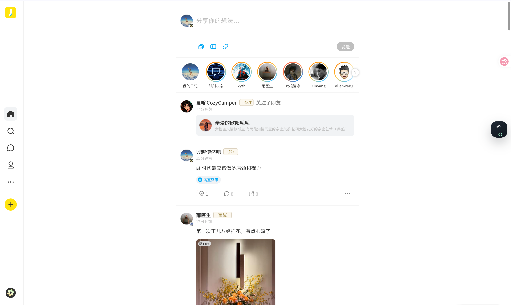

# 即刻私人备注

Chrome / Edge 本地扩展，支持私人备注、信息流阅读位置自动恢复，以及页面内悬浮工具球。在即刻网页版昵称后显示「+ 备注」，点击后填写私人备注；已有备注以浅色标签显示原文，不额外添加括号。点击可修改，清空后保存即可删除。

## 自动恢复阅读位置

默认自动记录、自动恢复关闭。浏览信息流时自动记录当前动态与屏幕偏移；开启自动恢复后，刷新、重新打开网站，或从其他页面返回时，优先定位到上次看到的动态。未开启时可通过悬浮球手动恢复；进入页面及操作悬浮球不会覆盖原记录，主动浏览后再更新。首页 `/` 与 `/following` 共用记录，发现 `/explore`、各用户的个人主页动态分别记录，并按当前登录用户区分。

在信息流页面右下角会显示即刻图标悬浮球。点击后可以：

- 「回到顶部」：滚动当前信息流容器到顶部，保留原阅读记录，便于再次手动返回。
- 「回到上次浏览位置」：手动触发一次已保存阅读位置的恢复。
- 「设置」：打开与浏览器工具栏扩展弹窗相同的设置、阅读记录清除和备注备份面板。悬浮球可拖动，设置面板点击遮罩或右上角关闭。

点击浏览器工具栏的扩展图标，也可以：

- 开关「自动恢复阅读位置」，默认关闭。阅读位置默认仍会自动记录；打开后，进入信息流时自动跳转到上次位置。关闭此开关不会停止记录，悬浮球的「回到上次浏览位置」仍可手动恢复。升级后保留已经保存的开关选择；没有保存过选择时默认关闭。
- 开关「限制阅读记录有效期」，默认开启，默认有效期为 **24 小时**，可输入 **1～8760 的整数小时数**。直接按距上次记录的实际小时数计算，不按自然日取整；超过有效期后，扩展不会自动跳转，也不会自动刷新旧记录的时间，直到你主动浏览才更新阅读位置。关闭此限制后，记录长期有效。未配置过有效期的用户升级后使用 24 小时；已有天数配置会换算成小时保留，修改设置后以小时保存。
- 开关「显示恢复结果与撤销提示」。查找期间的取消按钮始终可用。
- 清除全部阅读位置，私人备注和设置保留；之后主动滚动才重新记录。

恢复时显示「正在查找上次阅读位置…」，可点「取消」回到进入时的位置；主动滚动、触摸或点击也会停止自动恢复。后台标签页会暂停查找，切到前台再继续。恢复完成后，提示中的「撤销恢复」可回到进入时的位置。

精确恢复成功后，页面会显示「上次读到这里」分割线，标记这次返回时的原阅读位置；长动态读到中途时也能看到标记。分割线随内容滚动，不会因继续浏览而移动到新的记录处，也不改变信息流布局或拦截点击。关闭结果提示后仍会显示分割线；撤销恢复、切换页面或账号、关闭自动恢复、清除阅读记录时移除。取消查找、记录过期或仅近似恢复时不显示分割线。

如果目标动态尚未加载，扩展会通过页面原有滚动加载逐步查找，最多 30 秒或 80 次滚动，不会无限翻页。找到后会短暂校正图片等内容造成的位置变化；未找到时只能回到已加载列表中的近似滚动位置，并明确提示。近似恢复和取消均不会覆盖原阅读记录，直到你主动继续浏览。

发现页的推荐排序、动态删除、间隔过久或即刻改版都可能使精确恢复失败。动态详情、相册、收藏、圈子、搜索和通知不单独记录；即刻原生返回位置仍可能生效。记录的是最近浏览处，不判断动态是否已经读完。多标签页按最后保存的阅读位置恢复，已有标签页不会因另一个标签页保存而突然跳转。

## 效果预览

实际使用截图：备注显示在用户名旁边；个人主页的分类导航标签（动态、相册、收藏、我的圈子）旁边不会显示备注。

以下截图为早期版本，当前版本已去掉备注两侧自动添加的括号。



个人主页中的显示效果：


## 安装

1. 在 [GitHub 仓库](https://github.com/ryohgicc/jikeusernotes) 点击「Code → Download ZIP」并解压，或克隆仓库：`git clone https://github.com/ryohgicc/jikeusernotes.git`。也可使用单独提供的扩展 ZIP。
2. Chrome 打开 `chrome://extensions`；Edge 打开 `edge://extensions`。
3. 开启「开发者模式」，点击「加载已解压的扩展程序」（Edge 可能显示「加载解压缩的扩展」）。
4. 选择直接包含 `manifest.json` 的文件夹。GitHub ZIP 通常解压为 `jikeusernotes-main`，克隆目录为 `jikeusernotes`，单独提供的扩展 ZIP 解压为 `jike-notes`。
5. 打开或刷新即刻个人主页（例如 `https://web.okjike.com/u/你的用户名`），点击用户名后面的「+ 备注」。

安装后不要移动或删除该文件夹。替换扩展代码后，在扩展管理页点击「重新加载」，再刷新即刻网页。

## 数据和权限

- 备注绑定个人主页链接里的用户标识 `username`，不按显示昵称匹配；同名用户互不影响。如果即刻更改这个标识，旧备注需要重新关联。
- 数据使用 `chrome.storage.local`，仅当前浏览器配置文件可见。切换即刻账号仍共用私人备注；阅读位置按登录用户隔离，不会显示给别人，也不上传到即刻。
- 支持刷新保留、多标签页更新、首页动态和动态详情页中的作者昵称。
- 备注入口显示在用户名旁边；个人主页分类导航标签（动态、相册、收藏、我的圈子）旁边不会显示备注。
- 点击浏览器工具栏的扩展图标，可导出 JSON 备注备份或导入备份；导入会合并，同一用户以导入值为准。备注备份不含阅读记录或阅读设置。
- 不自动跨设备同步，不向即刻 App 添加备注。卸载扩展、删除浏览器配置文件或清除扩展存储会删除本地数据，请提前导出。
- 仅申请扩展存储权限，内容脚本仅运行于 `https://web.okjike.com/*`；没有远程脚本或遥测，也不自行调用即刻 API。恢复时的滚动会触发即刻自身的正常分页请求。
- 阅读记录只包含动态 ID、滚动位置、视口偏移和保存时间，不保存动态正文、图片、登录令牌或接口响应。识别不到侧边栏的登录用户时，不记录或恢复。

## 实现与验证

原生 JavaScript、Manifest V3，安装使用无需依赖、无需构建。`content.js` 处理昵称备注；`popup.js` 提供备注备份和阅读设置。`reading.js` 在扩展隔离环境中记录和恢复内部滚动容器，处理单页导航、主动操作取消与异步布局。

即刻会卸载屏幕外动态，且未在 DOM 上公开动态 ID。`reading-bridge.js` 在页面 MAIN 环境中只读已渲染动态的 React props，将 ID 标记到保留的虚拟列表容器；扩展隔离环境通过这些标记定位，不读取认证信息或改写即刻内部缓存。此适配依赖当前的页面结构和 React 实现，改版后可能需要更新；识别失败时保留旧记录，不声称精确恢复。

本地开发与验证（Node.js 20+）：

```bash
npm ci
npx playwright install chromium
npm run lint
npm test
python3 -m json.tool manifest.json
```

`npm run lint` 做 JavaScript 语法检查。自动化测试使用与即刻公开代码相同形态的内部滚动容器和虚拟列表，覆盖新增动态、刷新、单页导航、分页查找、布局变化、取消与撤销、账号隔离、开关、记录过期、自定义有效期、输入校验、阅读分割线随滚动和布局变化的定位、移除、页面内悬浮球三项操作和设置面板。测试还会实际加载 MV3 扩展，验证 MAIN/隔离环境协作、真实扩展存储和备注兼容性。`CHROME_PATH` 可指定普通测试浏览器；`EXTENSION_CHROME_PATH` 可指定支持加载未打包扩展的 Chromium / Chrome for Testing。

2026-11-19 已在本地测试页面验证，尚未在你的已登录即刻会话中实测。早期备注验证还覆盖增删改、同名隔离、动态加载、保存失败和备份导入导出。即刻更新页面结构或路由后可能需要适配；头像链接、纯文本昵称及非标准姓名组件不保证覆盖。
